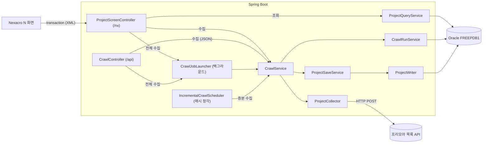
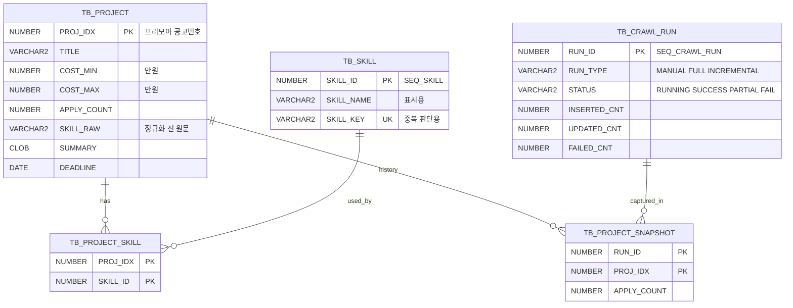
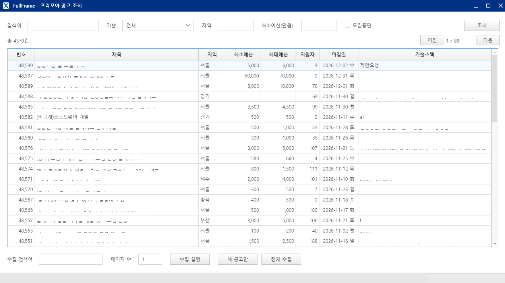

# freemoa-crawler

프리랜서 플랫폼 프리모아의 프로젝트 공고를 수집해 Oracle에 적재하고,
넥사크로 N 화면에서 조회와 수집 실행까지 할 수 있는 학습용 백엔드 프로젝트.
처음 한 번 전체 공고를 받고, 이후에는 배치가 매시 새 공고만 가져온다.

Java 기본기(DI, 예외, 컬렉션/스트림), Oracle SQL(정규화, MERGE, 서브쿼리, 페이징),
트랜잭션, 넥사크로 연동, Git 브랜치/PR 흐름을 단계별로 쌓는다.

## 기술 스택

| 구분 | 기술 |
|---|---|
| Language | Java 17 |
| Framework | Spring Boot 3.5, MyBatis 3 |
| Database | Oracle AI Database 26ai Free (PDB: `FREEPDB1`) |
| Frontend | Nexacro N |
| Build | Maven |
| Test | JUnit 5, AssertJ |

## 전체 흐름



### 수집 종류

| 종류 | 시작 | 범위 | 응답 |
|---|---|---|---|
| 수동 (MANUAL) | `POST /api/crawl?maxPages=N`, 화면 수집 실행 | 지정한 페이지 수 (1~30) | 끝날 때까지 기다림 |
| 전체 (FULL) | `POST /api/crawl/all`, 화면 전체 수집 | 마지막 페이지까지 | runId 즉시 응답 (202), 진행 상황은 폴링 |
| 증분 (INCREMENTAL) | 배치 (평일 9~18시 매시 정각), 화면 새 공고만 | 새 공고 없는 페이지가 2번 연속이면 종료 | 끝날 때까지 기다림 |

세 가지 모두 `CrawlService.execute()` 하나로 돌고, "몇 페이지까지, 언제 멈추나"만 다르다.

### 수집 요청 한 번이 지나가는 길

| 순서 | 파일 | 하는 일 | 트랜잭션 |
|---|---|---|---|
| 1 | `crawler/CrawlController`, `screen/ProjectScreenController` | 요청 받기, 예외를 응답 형식으로 변환 | - |
| 2 | `crawler/CrawlService` | 검증 → 시작 기록 → 수집 → 저장 → 종료 기록 조율 | 없음 |
| 3 | `crawler/run/CrawlRunService` | `TB_CRAWL_RUN`에 RUNNING 등록 (이미 있으면 거절) | REQUIRES_NEW |
| 4 | `crawler/ProjectCollector` | 페이지 반복, 1초 대기, 네트워크 오류 재시도, 페이지마다 콜백 | 없음 |
| 5 | `crawler/api/FreemoaApiClient` | 프리모아에 HTTP POST, JSON 파싱 | 없음 |
| 6 | `crawler/convert/ProjectConverter` | 문자열 → 숫자/날짜, 예산 0 → null, 기술스택 정리 | 없음 |
| 7 | `project/ProjectSaveService` | (페이지마다) 신규/갱신 판단, 건별 저장 반복, 실패 집계 | 없음 |
| 8 | `project/ProjectWriter` | 공고 MERGE → 기술 매핑 재등록 → 스냅샷 INSERT | 건별 1개 |
| 9 | `project/SkillService` | 기술 마스터 MERGE | REQUIRES_NEW |
| 10 | `crawler/run/CrawlRunService` | (페이지마다) 진행 건수 갱신, 끝나면 SUCCESS / PARTIAL / FAIL 기록 | REQUIRES_NEW |

### 조회 요청

`POST /nx/projects/search` → `ProjectScreenController` → `ProjectQueryService` (readOnly)
→ `ProjectQueryMapper.xml` (동적 WHERE, EXISTS 서브쿼리, LISTAGG, OFFSET/FETCH 페이징)

## 소스 트리

```
freemoa-crawler
├── db/
│   ├── 01_create_tables.sql ............ 테이블·시퀀스·인덱스 DDL                [1]
│   ├── 02_alter_crawl_run.sql .......... 이력 컬럼 추가, 동시 실행 방지 인덱스   [4]
│   ├── 03_alter_crawl_run_type.sql ..... 수집 종류(RUN_TYPE) 컬럼                [6]
│   └── 99_drop_tables.sql .............. 전체 초기화                             [1]
├── docs/ ............................... 단계별 설계 이유·개념 정리 (아래 문서 목록)
├── http/crawl.http ..................... IntelliJ에서 바로 API 호출              [3→6]
├── nexacro/
│   ├── frmProjectList.xfdl ............. 공고 목록/검색/수집 화면 (Studio로 Import) [5→6]
│   ├── frmProjectList.js ............... 위 화면 스크립트 (xfdl 안 스크립트와 동일)
│   ├── frmStats.xfdl ................... 백엔드 기술 수요 통계 화면 (목록의 [통계 보기])
│   ├── frmStats.js ..................... 위 화면 스크립트 (xfdl 안 스크립트와 동일)
│   └── datasets.xml .................... 화면 Dataset 컬럼 정의                  [5]
├── src/main/java/com/lhk/freemoa/
│   ├── FreemoaCrawlerApplication.java .. 스프링 부트 시작점
│   ├── config/WebConfig.java ........... CORS 설정                               [5]
│   ├── health/ ......................... DB 연결 확인 (/health/db)               [1]
│   ├── crawler/ ........................ 수집
│   │   ├── CrawlController.java ........ /api/crawl, /all, /incremental, /runs   [3→6]
│   │   ├── CrawlService.java ........... 수집 → 페이지별 저장 조율, 멈춤 조건    [3→6]
│   │   ├── CrawlJobLauncher.java ....... 전체 수집을 백그라운드 스레드로         [6]
│   │   ├── CrawlAsyncConfig.java ....... 수집 전용 스레드 풀 (crawl-1)           [6]
│   │   ├── IncrementalCrawlScheduler.java  증분 배치 (@Scheduled)                [6]
│   │   ├── CrawlResult.java ............ 수집 결과                               [3→4]
│   │   ├── CrawlerConfig.java .......... 크롤러 객체 @Bean 조립                  [3]
│   │   ├── CrawlerProperties.java ...... crawler.* 설정                          [3]
│   │   ├── ProjectCollector.java ....... 페이지 순회, 딜레이, 재시도             [2→6]
│   │   ├── PlainCrawlerMain.java ....... 스프링 없이 직접 조립해서 실행          [2]
│   │   ├── run/ ........................ 수집 이력                               [4]
│   │   │   ├── CrawlRunService.java .... 시작/종료 기록 (REQUIRES_NEW)
│   │   │   ├── CrawlRunMapper.java
│   │   │   ├── CrawlStatus.java ........ RUNNING / SUCCESS / PARTIAL / FAIL
│   │   │   ├── CrawlRunType.java ....... MANUAL / FULL / INCREMENTAL             [6]
│   │   │   ├── CrawlRunView.java ....... 진행 상황 조회 결과 (record)            [6]
│   │   │   ├── CrawlRunRecovery.java ... 서버 시작 시 남은 RUNNING 정리          [6]
│   │   │   └── CrawlAlreadyRunningException.java
│   │   ├── api/
│   │   │   ├── FreemoaApiClient.java ... HTTP 요청 + JSON 파싱                   [2]
│   │   │   ├── FreemoaApiException.java  외부 API 실패 (언체크 예외)             [2]
│   │   │   └── dto/FreemoaListResponse.java  응답 원본 형태                      [2]
│   │   ├── convert/
│   │   │   ├── ProjectConverter.java ... 외부 형식 → 내부 형식                   [2]
│   │   │   └── SkillParser.java ........ 기술스택 정리·중복 제거                 [2]
│   │   └── domain/Project.java ......... 정리된 공고 객체 (불변 record)          [2]
│   ├── project/ ........................ 저장·조회
│   │   ├── ProjectSaveService.java ..... 건별 저장 반복 + 실패 집계              [3→4]
│   │   ├── ProjectWriter.java .......... 공고 1건 저장 (@Transactional)          [4]
│   │   ├── SkillService.java ........... 기술 마스터 등록 (REQUIRES_NEW)         [4]
│   │   ├── SaveResult.java ............. 신규/갱신/실패 건수                     [3→4]
│   │   ├── mapper/ ..................... 저장용 매퍼                             [3→4]
│   │   └── query/ ...................... 조회용 (검색 VO, 결과 VO, 매퍼, 서비스) [5]
│   ├── nexacro/ ........................ 넥사크로 XML 읽기/쓰기                  [5]
│   │   ├── NxXmlReader.java ............ 요청 XML → 파라미터 (XXE 방어)
│   │   ├── NxXmlWriter.java ............ Dataset → 응답 XML (이스케이프)
│   │   └── NxDataset, NxRequest, NxType, NxResponses
│   └── screen/ ......................... 화면용 API                              [5]
│       ├── ProjectScreenController.java  /nx/skills, /nx/projects/search, /nx/crawl/**
│       └── NexacroExceptionHandler.java  예외 → ErrorCode -1
├── src/main/resources/
│   ├── application.yml ................. DB, MyBatis, crawler, nexacro 설정
│   └── mapper/ ......................... SQL (MERGE, 동적 조회 등)
└── src/test/java/com/lhk/freemoa/
    ├── crawler/convert/ ................ 변환 로직 테스트 + JSON 샘플            [2]
    ├── nexacro/NxXmlTest.java .......... XML 읽기/쓰기, XXE, 이스케이프 테스트   [5]
    └── txlab/TransactionLabTest.java ... 전파·프록시·롤백 규칙 실험 (실제 DB)   [4]
```

## ERD



## 진행 현황

| 단계 | 내용 | 핵심 | 상태 |
|---|---|---|---|
| 1 | 프로젝트 뼈대 + DDL | 정규화(N:M), 자연키 vs 대리키, CLOB, 인덱스 | 완료 |
| 2 | 순수 Java 수집기 | 생성자 주입, 예외 전환, record, Stream, 단위 테스트 | 완료 |
| 3 | Spring 이전 + DB 저장 | IoC/DI, @Bean vs @Component, MyBatis, MERGE INTO | 완료 |
| 4 | 트랜잭션 | 건별 트랜잭션, REQUIRES_NEW, 롤백 규칙, 프록시 함정, 동시 실행 방지 | 완료 |
| 5 | 넥사크로 N 화면 | Dataset XML, 동적 SQL, 서브쿼리, 페이징, CORS, XXE | 완료 |
| 6 | 전체 수집 + 증분 배치 | 백그라운드 스레드, @Scheduled, 페이지 단위 저장, 재시도·백오프, 폴링 | 완료 |
| 7 | 테스트 코드 + API 문서 | JUnit·Mockito, MockMvc, Spring REST Docs | 예정 |
| 8 | 공고 원본 보존 + 삭제 감지 | 원본 JSON 보관, 사라진 공고 표시 | 예정 |
| 9 | 통계 화면 (SQL 심화) | 집계, 윈도우 함수, 비율 분석 | 예정 |

## 문서

| 문서 | 내용 |
|---|---|
| `docs/01-setup-and-ddl.md` | Oracle 설치, 계정, 테이블 설계 |
| `docs/02-plain-java-crawler.md` | 스프링 없이 짠 수집기, 프리모아 API 분석 |
| `docs/03-spring-and-merge.md` | IoC/DI, MERGE INTO |
| `docs/04-transaction.md` | 트랜잭션 경계, 전파, 롤백 규칙 |
| `docs/05-nexacro.md` | 넥사크로 연동, Studio 작업 순서, CORS |
| `docs/06-troubleshooting.md` | 실제로 막혔던 오류와 해결 |
| `docs/07-full-and-incremental.md` | 전체 수집, 증분 배치, 화면 폴링 |
| `docs/08-study-notes-1119.md` | 학습 노트 (DB 설계, 파싱 흐름, 배치, 디버깅) |
| `docs/09-debugging-and-postman.md` | 디버깅 실습, Postman 컬렉션 |
| `docs/10-test-and-restdocs.md` | JUnit·Mockito, REST Docs, Swagger 비교 |
| `docs/11-stats-and-jpa.md` | 백엔드 기술 수요 통계(기술 묶음, 같이 요구되는 기술), 윈도우 함수, JPA vs MyBatis |
| `docs/12-crawling-flow.md` | 크롤링 흐름 한눈에 (그림 + 단계별 소스 연결) |
| `docs/13-study-notes-1123.md` | 학습 노트 (N:M, 식별 관계, 트랜잭션 범위, record, 예외, Map 기초, jshell) |

### 애플리케이션
- API 호출: `http/crawl.http`

| API | 설명 |
|---|---|
| `POST /api/crawl?keyword=java&maxPages=2` | 수동 수집 |
| `POST /api/crawl/all` | 전체 수집 접수 (202 + runId) |
| `GET /api/crawl/runs/{runId}` | 수집 진행 상황 |
| `POST /api/crawl/incremental` | 증분 수집 1회 즉시 실행 |

증분 배치 주기는 `application.yml`의 `crawler.incremental.cron`, 끄려면 `enabled: false`.

### 넥사크로 화면
`docs/05-nexacro.md` 참고

### 스프링 없이 수집기만 실행
`PlainCrawlerMain` 실행. Program arguments로 `검색어 최대페이지` (예: `java 3`)

## 수집 원칙
- `robots.txt`에서 허용된 목록 경로만 사용하고, 페이지 사이에 1초 딜레이를 둔다.
- 요청 실패 시 재시도는 최대 3번, 간격을 늘려가며 한다 (상대 서버 부담 최소화).
- User-Agent에 학습용 프로그램임을 밝힌다.
- 의뢰인 이메일 등 개인정보는 수집하지 않는다. (응답에 있어도 DTO에 필드를 두지 않음)
- 수집 데이터는 개인 학습 용도로만 사용한다.

## 실행 화면

