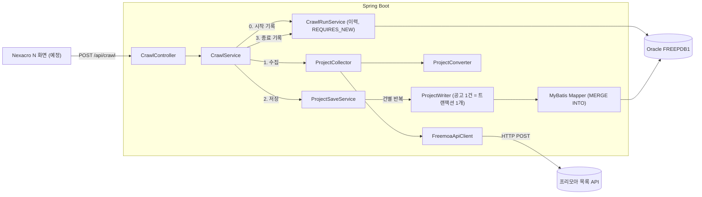
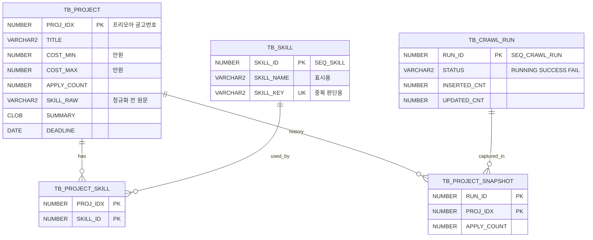

# 📋 freemoa-crawler

> 프리랜서 플랫폼 **프리모아**의 프로젝트 공고를 수집해 Oracle에 적재하고,
> **넥사크로 N** 화면에서 조회·통계·엑셀 다운로드까지 제공하는 SI 스타일 백엔드 프로젝트

기능을 많이 붙이는 것보다 **SI 현장에서 매일 쓰는 기술을 깊게** 다루는 것이 목표다.
Java 기본기(DI, 예외, 컬렉션/스트림), Oracle SQL(정규화, MERGE, 서브쿼리, 윈도우 함수, 프로시저),
트랜잭션, 그리고 Git 브랜치/PR 흐름을 단계별로 쌓는다.

<br>

## 🛠 기술 스택

| 구분 | 기술 |
|---|---|
| Language | Java 17 |
| Framework | Spring Boot 3.5, MyBatis 3 |
| Database | Oracle AI Database 26ai Free (PDB: `FREEPDB1`) |
| Frontend | Nexacro N (예정) |
| Build | Maven |
| Test | JUnit 5, AssertJ |

<br>

## 🗺 전체 흐름



### 요청 한 번이 지나가는 길
`POST /api/crawl?keyword=java&maxPages=2` 를 호출하면

| 순서 | 파일 | 하는 일 |
|---|---|---|
| 순서 | 파일 | 하는 일 | 트랜잭션 |
|---|---|---|---|
| 1 | `crawler/CrawlController` | 요청 파라미터 받기, 예외를 400/409/502로 변환 | - |
| 2 | `crawler/CrawlService` | 검증 → 시작 기록 → 수집 → 저장 → 종료 기록 조율 | 없음 |
| 3 | `crawler/run/CrawlRunService` | `TB_CRAWL_RUN`에 RUNNING 등록 (이미 있으면 409) | REQUIRES_NEW |
| 4 | `crawler/ProjectCollector` | 1~N 페이지 반복, 페이지 사이 1초 대기 | 없음 |
| 5 | `crawler/api/FreemoaApiClient` | 프리모아에 HTTP POST, JSON → `FreemoaListResponse` | 없음 |
| 6 | `crawler/convert/ProjectConverter` | 문자열 → 숫자/날짜, 예산 0 → null, 기술스택 정리 | 없음 |
| 7 | `project/ProjectSaveService` | 중복 제거, 신규/갱신 판단, 건별 저장 반복, 실패 집계 | 없음 |
| 8 | `project/ProjectWriter` | 공고 MERGE → 기술 매핑 재등록 → 스냅샷 INSERT | **건별 1개** |
| 9 | `project/SkillService` | 기술 마스터 MERGE | REQUIRES_NEW |
| 10 | `crawler/run/CrawlRunService` | SUCCESS / PARTIAL / FAIL 기록 | REQUIRES_NEW |
| - | `resources/mapper/**/*.xml` | 실제 SQL | - |

<br>

## 📂 소스 트리

```
freemoa-crawler
├── db/
│   ├── 01_create_tables.sql ............ 테이블·시퀀스·인덱스 DDL                [1단계]
│   ├── 02_alter_crawl_run.sql .......... 이력 컬럼 추가, 동시 실행 방지 인덱스   [4단계]
│   └── 99_drop_tables.sql .............. 전체 초기화                             [1단계]
├── docs/ ............................... 단계별 설계 이유·개념 정리
├── http/
│   └── crawl.http ...................... IntelliJ에서 바로 API 호출              [3단계]
├── src/main/java/com/lhk/freemoa/
│   ├── FreemoaCrawlerApplication.java .. 스프링 부트 시작점
│   ├── health/ ......................... DB 연결 확인 API (/health/db)          [1단계]
│   ├── crawler/ ........................ ── 수집 ──
│   │   ├── CrawlController.java ........ POST /api/crawl                         [3단계]
│   │   ├── CrawlService.java ........... 수집 → 저장 조율                        [3단계]
│   │   ├── CrawlResult.java ............ 수집 결과 응답 (record)                 [3단계]
│   │   ├── CrawlerConfig.java .......... 크롤러 객체들을 @Bean으로 조립          [3단계]
│   │   ├── CrawlerProperties.java ...... application.yml의 crawler.* 설정        [3단계]
│   │   ├── ProjectCollector.java ....... 페이지 순회 + 딜레이                    [2단계]
│   │   ├── PlainCrawlerMain.java ....... 스프링 없이 직접 조립해서 실행          [2단계]
│   │   ├── run/ ........................ 수집 이력                               [4단계]
│   │   │   ├── CrawlRunService.java .... 시작/종료 기록 (REQUIRES_NEW)
│   │   │   ├── CrawlRunMapper.java
│   │   │   ├── CrawlStatus.java ........ RUNNING / SUCCESS / PARTIAL / FAIL
│   │   │   └── CrawlAlreadyRunningException.java  → 409
│   │   ├── api/
│   │   │   ├── FreemoaApiClient.java ... HTTP 요청 + JSON 파싱                   [2단계]
│   │   │   ├── FreemoaApiException.java  외부 API 실패 예외 (언체크)             [2단계]
│   │   │   └── dto/FreemoaListResponse.java  응답 원본 형태 (전부 String)        [2단계]
│   │   ├── convert/
│   │   │   ├── ProjectConverter.java ... 외부 형식 → 내부 형식 변환              [2단계]
│   │   │   └── SkillParser.java ........ 기술스택 문자열 정리·중복 제거          [2단계]
│   │   └── domain/
│   │       └── Project.java ............ 정리된 공고 객체 (불변 record)          [2단계]
│   └── project/ ........................ ── 저장 ──
│       ├── ProjectSaveService.java ..... 건별 저장 반복 + 실패 집계              [3→4단계]
│       ├── ProjectWriter.java .......... 공고 1건 저장 (@Transactional)          [4단계]
│       ├── SkillService.java ........... 기술 마스터 등록 (REQUIRES_NEW)         [4단계]
│       ├── SaveResult.java ............. 신규/갱신/실패 건수                     [3→4단계]
│       └── mapper/ ..................... MyBatis 매퍼 인터페이스                 [3단계]
│           ├── ProjectMapper.java
│           ├── SkillMapper.java
│           ├── ProjectSkillMapper.java
│           └── SnapshotMapper.java ..... 회차별 스냅샷                           [4단계]
├── src/main/resources/
│   ├── application.yml ................. DB 접속, MyBatis, crawler 설정
│   └── mapper/
│       ├── HealthMapper.xml
│       └── project/ .................... MERGE INTO 등 실제 SQL                  [3~4단계]
└── src/test/java/com/lhk/freemoa/
    ├── crawler/convert/ ................ 변환 로직 단위 테스트 + JSON 샘플      [2단계]
    └── txlab/TransactionLabTest.java ... 전파·프록시·롤백 규칙 실험 (실제 DB)   [4단계]
```

<br>

## 🗂 ERD



<br>

## 🚀 진행 현황

| # | 단계 | 핵심 학습 포인트 | 상태 |
|---|---|---|---|
| 1 | 프로젝트 뼈대 + DDL | 정규화(N:M), 자연키 vs 대리키, CLOB, 인덱스 | ✅ |
| 2 | 순수 Java 수집기 | 생성자 주입, 예외 전환, record, Stream, 단위 테스트 | ✅ |
| 3 | Spring 이전 + DB 저장 | IoC/DI, @Bean vs @Component, MyBatis, `MERGE INTO` | ✅ |
| 4 | 트랜잭션 | 건별 트랜잭션, `REQUIRES_NEW`, 롤백 규칙, 프록시 함정, 동시 실행 방지 | ✅ |
| 5 | 넥사크로 N 화면 | Dataset 연동, 조회 조건·그리드 | ⏳ |
| 6 | 엑셀 다운로드 | Apache POI(SXSSF), 수식 인젝션 방어 | ⏳ |
| 7 | SQL 심화 | 서브쿼리, 윈도우 함수, 집계 프로시저 | ⏳ |

단계별 설계 이유와 개념 정리는 [`docs/`](docs) 참고.

<br>

## ▶️ 실행 방법

<details>
<summary><b>1. DB 준비</b></summary>

1. Oracle Free 설치 후 `system` 계정으로 `FREEPDB1` 접속
2. 프로젝트 계정 생성
   ```sql
   CREATE USER freemoa IDENTIFIED BY "비밀번호"
     DEFAULT TABLESPACE USERS QUOTA UNLIMITED ON USERS;
   GRANT CREATE SESSION, CREATE TABLE, CREATE VIEW,
         CREATE SEQUENCE, CREATE PROCEDURE, CREATE TRIGGER TO freemoa;
   ```
3. `freemoa` 계정으로 `db/` 폴더의 스크립트를 **번호 순서대로** 실행 (`01` → `02`)
</details>

<details>
<summary><b>2. 애플리케이션 실행</b></summary>

DB 비밀번호는 코드에 두지 않고 환경변수로 주입한다.
```
DB_PASSWORD=비밀번호
```
- IntelliJ: `Run > Edit Configurations > Environment variables`
- 확인: http://localhost:8080/health/db
</details>

<details>
<summary><b>3. 수집 실행</b></summary>

- IntelliJ: `http/crawl.http` 열고 요청 옆 ▶ 클릭
- 명령 프롬프트: `curl -X POST "http://localhost:8080/api/crawl?keyword=java&maxPages=2"`

```json
{ "runId": 1, "status": "SUCCESS", "keyword": "java", "maxPages": 2,
  "fetched": 20, "inserted": 20, "updated": 0, "failed": 0, "elapsedMs": 2431 }
```
</details>

<details>
<summary><b>4. 순수 Java 수집기만 실행 (DB 불필요)</b></summary>

`PlainCrawlerMain` 실행. Program arguments로 `검색어 최대페이지` 지정 (예: `java 3`)
</details>

<br>

## 🔒 수집 원칙
- `robots.txt`에서 허용된 목록 경로만 사용하고, 페이지 사이에 1초 딜레이를 둔다.
- User-Agent에 학습용 프로그램임을 밝힌다.
- 의뢰인 이메일 등 **개인정보는 수집하지 않는다.** (응답에 포함돼 있어도 DTO에 필드를 두지 않음)
- 수집 데이터는 개인 학습 용도로만 사용한다.
