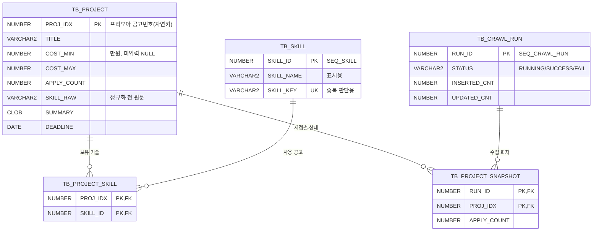

# 📋 freemoa-crawler

> 프리랜서 플랫폼 **프리모아**의 프로젝트 공고를 수집해 Oracle에 적재하고,
> **넥사크로 N** 화면에서 조회·통계·엑셀 다운로드까지 제공하는 SI 스타일 백엔드 프로젝트

기능을 많이 붙이는 것보다 **SI 현장에서 매일 쓰는 기술을 깊게** 다루는 것이 목표다.
Java 기본기(DI, 예외, 컬렉션/스트림), Oracle SQL(정규화, MERGE, 서브쿼리, 윈도우 함수, 프로시저),
트랜잭션, 그리고 Git 브랜치/PR 흐름을 단계별로 쌓는다.

<br>

## 🛠 기술 스택

| 구분 | 기술 |
|---|---|
| Language | Java 17 |
| Framework | Spring Boot 3.5, MyBatis 3 |
| Database | Oracle AI Database 26ai Free (PDB: `FREEPDB1`) |
| Frontend | Nexacro N (예정) |
| Build | Maven |
| Test | JUnit 5, AssertJ |

<br>

## 🏗 아키텍처

```mermaid
flowchart LR
    FM[(프리모아<br/>목록 API)] -->|HTTP POST / JSON| C[Collector]
    subgraph Spring Boot
        C --> CV[Converter<br/>타입 변환·기술스택 정규화]
        CV --> S[Service<br/>@Transactional]
        S --> M[MyBatis Mapper<br/>MERGE INTO]
        API[Controller] --> S
    end
    M --> DB[(Oracle<br/>FREEPDB1)]
    NX[Nexacro N 화면] -->|조회 / 엑셀| API
```

<br>

## 🗂 ERD



<br>

## 🚀 진행 현황

| # | 단계 | 핵심 학습 포인트 | 상태 |
|---|---|---|---|
| 1 | 프로젝트 뼈대 + DDL | 정규화(N:M), 자연키 vs 대리키, CLOB, 인덱스 | ✅ |
| 2 | 순수 Java 수집기 | 생성자 주입, 예외 전환, record, Stream, 단위 테스트 | ✅ |
| 3 | Spring 이전 + DB 저장 | IoC/DI 체감, MyBatis, `MERGE INTO` | ⏳ |
| 4 | 트랜잭션 | 경계 설정, `REQUIRES_NEW`, 롤백 규칙, 프록시 함정 | ⏳ |
| 5 | 넥사크로 N 화면 | Dataset 연동, 조회 조건·그리드 | ⏳ |
| 6 | 엑셀 다운로드 | Apache POI(SXSSF), 수식 인젝션 방어 | ⏳ |
| 7 | SQL 심화 | 서브쿼리, 윈도우 함수, 집계 프로시저 | ⏳ |

단계별 설계 이유와 개념 정리는 [`docs/`](docs) 참고.

<br>

## ▶️ 실행 방법

<details>
<summary><b>1. DB 준비</b></summary>

1. Oracle Free 설치 후 `system` 계정으로 `FREEPDB1` 접속
2. 프로젝트 계정 생성
   ```sql
   CREATE USER freemoa IDENTIFIED BY "비밀번호"
     DEFAULT TABLESPACE USERS QUOTA UNLIMITED ON USERS;
   GRANT CREATE SESSION, CREATE TABLE, CREATE VIEW,
         CREATE SEQUENCE, CREATE PROCEDURE, CREATE TRIGGER TO freemoa;
   ```
3. `freemoa` 계정으로 `db/01_create_tables.sql` 실행
</details>

<details>
<summary><b>2. 애플리케이션 실행</b></summary>

DB 비밀번호는 코드에 두지 않고 환경변수로 주입한다.
```
DB_PASSWORD=비밀번호
```
- IntelliJ: `Run > Edit Configurations > Environment variables`
- 확인: http://localhost:8080/health/db
</details>

<details>
<summary><b>3. 순수 Java 수집기만 실행 (DB 불필요)</b></summary>

`PlainCrawlerMain` 실행. Program arguments로 `검색어 최대페이지` 지정 (예: `java 3`)
</details>

<br>

## 🔒 수집 원칙
- `robots.txt`에서 허용된 목록 경로만 사용하고, 페이지 사이에 1초 딜레이를 둔다.
- User-Agent에 학습용 프로그램임을 밝힌다.
- 의뢰인 이메일 등 **개인정보는 수집하지 않는다.** (응답에 포함돼 있어도 DTO에 필드를 두지 않음)
- 수집 데이터는 개인 학습 용도로만 사용한다.
