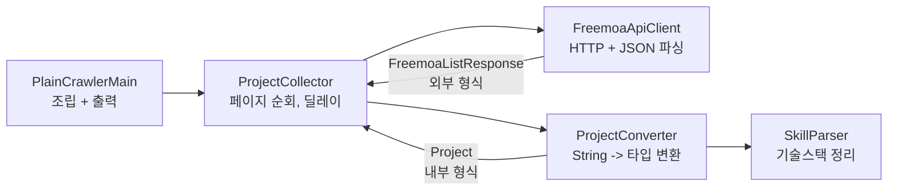

# 02. 순수 Java 수집기 (Spring 없이)

## 왜 Spring 없이 먼저 짜나
Spring을 쓰면 `@Service`, `@Autowired` 몇 줄로 객체가 알아서 연결된다.
편하지만 "무엇을 대신해주는지" 모르고 쓰게 된다.
`PlainCrawlerMain`의 조립 코드를 직접 보고 나면, 3단계에서 Spring이 정확히 어떤 일을 대신하는지 보인다.

## 구조

각 클래스는 한 가지 일만 한다. HTTP가 바뀌면 Client만, 변환 규칙이 바뀌면 Converter만 고친다.

## 프리모아 API 분석 결과
| 항목 | 값 |
|---|---|
| URL | `POST https://www.freemoa.net/m4a/s41a` |
| 요청 형식 | `application/x-www-form-urlencoded` |
| 파라미터 | `sS=검색어&page=1&mp=0&lp=0&st=stayAll&st2=&st3=` |
| 페이지 크기 | 10건 |
| 로그인 | 필요 없음 |
| 응답 Content-Type | `text/html` (실제 내용은 JSON) |
| robots.txt | `/m4/s41` Allow |

브라우저 개발자도구(F12) Network 탭에서 페이지 번호를 눌렀을 때 나가는 요청을 보고 찾았다.

## 이번 단계 Java 포인트
| 개념 | 어디서 |
|---|---|
| record, 컴팩트 생성자, 불변 리스트(`List.copyOf`) | `Project`, `FreemoaListResponse` |
| 생성자 주입 (DI의 본질) | 모든 클래스 |
| 체크 예외 → 언체크 예외 전환 | `FreemoaApiClient` |
| `InterruptedException` 올바른 처리 | `FreemoaApiClient`, `ProjectCollector` |
| `int` vs `Integer` (null 표현) | `Project.costMax` |
| `LinkedHashMap`으로 순서 유지 + 중복 제거 | `SkillParser` |
| `Locale.ROOT` | `SkillParser.toKey` |
| Stream: `flatMap`, `groupingBy`, `counting`, `OptionalDouble` | `PlainCrawlerMain` |
| 네트워크 없는 단위 테스트 (fixture) | `ProjectConverterTest` |

## 실행
- `PlainCrawlerMain` 실행 (DB 불필요)
- 검색어/페이지 바꾸기: Run Configuration > Program arguments → `spring 5`
- 테스트: `ProjectConverterTest`, `SkillParserTest` 우클릭 > Run
