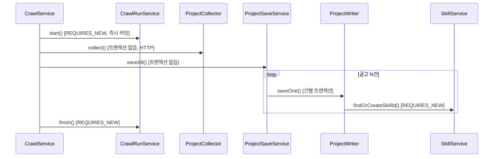

# 04. 트랜잭션

## 1. 무엇이 바뀌었나
| | 3단계 | 4단계 |
|---|---|---|
| 트랜잭션 단위 | `saveAll` 전체 1개 | 공고 1건당 1개 (`ProjectWriter.saveOne`) |
| 1건 실패 시 | 전체 롤백 | 그 1건만 롤백, 나머지 저장, 상태 `PARTIAL` |
| 수집 이력 | 없음 | `TB_CRAWL_RUN`에 RUNNING → SUCCESS/PARTIAL/FAIL |
| 동시 실행 | 막지 않음 | DB 유니크 인덱스로 차단 → 409 |
| 스냅샷 | 없음 | 수집 회차별 지원자 수 기록 |

## 2. 트랜잭션 구조



## 3. 전파 속성 (Propagation)
| 속성 | 바깥 트랜잭션이 있을 때 | 없을 때 | 이 프로젝트에서 |
|---|---|---|---|
| `REQUIRED` (기본값) | 합류한다 (같이 커밋/롤백) | 새로 연다 | `ProjectWriter.saveOne` |
| `REQUIRES_NEW` | 바깥을 잠시 멈추고 **새로** 연다 | 새로 연다 | `CrawlRunService`, `SkillService` |

`REQUIRES_NEW`는 커넥션을 하나 더 쓴다. 바깥 트랜잭션이 커넥션을 쥔 채로 새 커넥션을 요청하기 때문이다.
남발하면 커넥션 풀이 빨리 바닥나니까 "독립적으로 커밋돼야 하는 이유"가 있을 때만 쓴다.

### SkillService가 REQUIRES_NEW여야 하는 이유 (실제 버그 시나리오)
1. 공고 A 저장 중 새 기술 "Rust" 등록 → SKILL_ID 7, 캐시에 `RUST=7`
2. 공고 A의 다른 SQL 실패 → A 트랜잭션 롤백 → **"Rust" 행도 같이 사라짐**
3. 공고 B가 캐시에서 7을 꺼내 매핑 INSERT → 7번이 없으니 **FK 위반(ORA-02291)**

기술 마스터를 별도 트랜잭션으로 즉시 커밋하면, 캐시에 있는 ID는 항상 DB에 존재한다.

## 4. 프록시 함정 (self-invocation)
`@Transactional`은 스프링이 만든 **프록시 객체**가 호출을 가로채서 트랜잭션을 연다.

```
외부 → [프록시] → 진짜 객체.method()        트랜잭션 O
진짜 객체 내부에서 this.method()             프록시를 안 거침 → 트랜잭션 X
```
그래서 `saveOne`을 `ProjectSaveService`의 private 메서드로 두지 않고 `ProjectWriter`라는 별도 빈으로 뺐다.

## 5. 롤백 규칙
| 예외 종류 | 기본 동작 |
|---|---|
| `RuntimeException`, `Error` (언체크) | 롤백 |
| `Exception` (체크 예외, 예: `IOException`) | **커밋** |

체크 예외에서도 롤백하려면 `@Transactional(rollbackFor = Exception.class)`.
2단계에서 `IOException`을 `FreemoaApiException`(언체크)으로 감싼 이유 중 하나다.

## 6. 동시 실행 방지
```sql
CREATE UNIQUE INDEX UX_CRAWL_RUN_RUNNING
    ON TB_CRAWL_RUN (CASE WHEN STATUS = 'RUNNING' THEN 1 END);
```
- Oracle 인덱스는 키가 NULL인 행을 저장하지 않는다 → RUNNING 행만 인덱스에 들어감 → 1개만 허용
- "SELECT로 확인 → INSERT"는 두 요청이 동시에 확인하면 둘 다 통과한다. 확인과 등록을 DB 제약 한 번으로.

### 서버가 수집 도중 죽으면?
RUNNING 행이 남아서 다음 수집이 계속 409로 막힌다. 수동 복구:
```sql
UPDATE TB_CRAWL_RUN
   SET STATUS = 'FAIL', ENDED_AT = SYSDATE, ERROR_MSG = '수동 복구: 비정상 종료'
 WHERE STATUS = 'RUNNING';
COMMIT;
```

## 7. 실험 (TransactionLabTest)
`src/test/java/com/lhk/freemoa/txlab/TransactionLabTest` — 실제 Oracle에 쓰고 결과를 확인한다.

| 실험 | 기대 결과 |
|---|---|
| REQUIRED 안쪽 INSERT 후 바깥 예외 | INSERT 사라짐 |
| REQUIRES_NEW 안쪽 INSERT 후 바깥 예외 | INSERT 남음 |
| 프록시 경유 호출 후 예외 | 롤백됨 |
| this로 내부 호출 후 예외 | **롤백 안 됨** (트랜잭션 자체가 없었음) |
| 체크 예외 | **커밋됨** |
| `rollbackFor = Exception.class` + 체크 예외 | 롤백됨 |

실행: 테스트 실행 설정에도 `DB_PASSWORD` 환경변수 필요 (없으면 자동으로 건너뜀)

## 8. 확인용 SQL
```sql
-- 수집 이력
SELECT RUN_ID, STATUS, KEYWORD, STARTED_AT, ENDED_AT,
       FETCHED_CNT, INSERTED_CNT, UPDATED_CNT, FAILED_CNT, ERROR_MSG
  FROM TB_CRAWL_RUN
 ORDER BY RUN_ID DESC;

-- 회차별 스냅샷 (같은 공고를 여러 번 수집했을 때 지원자 수 변화)
SELECT S.PROJ_IDX, P.TITLE, S.RUN_ID, S.APPLY_COUNT, S.CAPTURED_AT
  FROM TB_PROJECT_SNAPSHOT S
  JOIN TB_PROJECT P ON P.PROJ_IDX = S.PROJ_IDX
 ORDER BY S.PROJ_IDX, S.RUN_ID;
```
