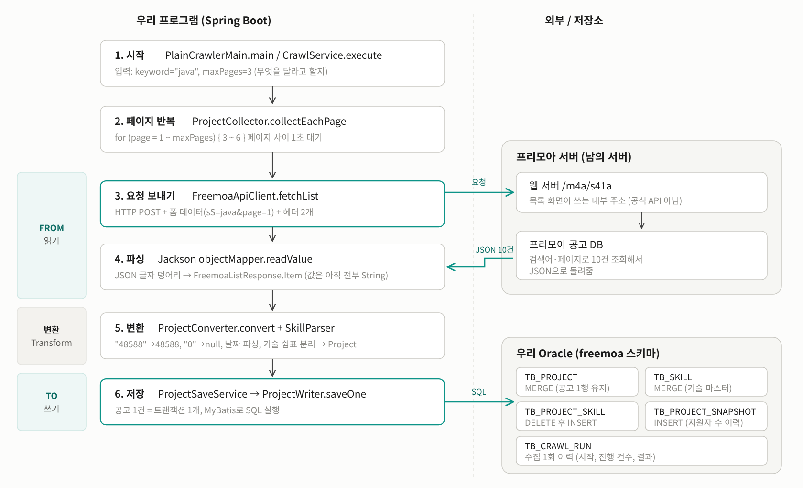

# 12. 크롤링 흐름 한눈에 보기

> 크롤링 = 남의 서버에 브라우저처럼 "데이터 줘"라고 요청하고, 돌려받은 JSON을 파싱·변환해서 우리 DB에 저장하는 것.

01~04 문서를 읽기 전에 이 문서로 전체 흐름을 먼저 잡고, 각 단계의 소스로 들어가면 된다.



(그림 원본: [images/crawling-flow.svg](images/crawling-flow.svg))

## 1. 출발점은 우리 프로그램이다

"프리모아에서 데이터가 들어와서 우리 코드가 실행된다"가 아니다. **우리 코드가 먼저 실행되고, 프리모아에 데이터를 달라고 요청하러 나간다.**

| 시작하는 곳 | 언제 | 파일 |
|---|---|---|
| `PlainCrawlerMain.main` | 2단계. 스프링 없이 콘솔에서 확인 | [PlainCrawlerMain.java](../src/main/java/com/lhk/freemoa/crawler/PlainCrawlerMain.java) |
| `CrawlService.execute` | 3단계 이후. API, 넥사크로 화면, 배치가 모두 여기로 들어온다 | [CrawlService.java](../src/main/java/com/lhk/freemoa/crawler/CrawlService.java) |

- 입력: `keyword`(검색어), `maxPages`(몇 페이지까지). 무엇을 달라고 할지 정하는 주문서다.
- 출력: `Project` 목록. 받아온 공고들이다.

## 2. 프리모아에서 무엇을 가져오나

프리모아 회사 서버에도 공고 DB가 있다. 브라우저로 목록 화면을 열면 이렇게 동작한다.
```
[브라우저]  "java 공고 1페이지 줘"  ->  [프리모아 웹 서버] -> [프리모아 공고 DB] 10건 조회
[브라우저]  <- JSON 10건 <-
[브라우저]  그 JSON으로 목록 화면을 그림
```
우리 크롤러는 브라우저 자리에 자바 프로그램이 들어간 것이다.
```
[우리 자바]  같은 요청  ->  [프리모아 서버]
[우리 자바]  <- 같은 JSON 10건 <-
[우리 자바]  화면 대신 우리 Oracle에 저장
```
- 가져오는 것: 프리모아 서버가 브라우저에게 주던 **공고 목록 데이터 그대로** (한 페이지 10건, JSON)
- 프리모아 DB에 직접 접속하는 게 아니다. 프리모아 웹 서버에 요청하면, 웹 서버가 자기 DB를 조회해서 결과만 JSON으로 준다.
- 공식 API가 아니라 목록 화면이 쓰는 내부 주소를 F12로 찾아서 흉내 낸 것이라 "크롤링"이라고 부른다.

## 3. 단계별로 소스와 연결

| 단계 | 하는 일 | 데이터 모양 | 소스 |
|---|---|---|---|
| 1. 시작 | 검색어, 페이지 수를 정함 | `"java"`, `3` | [CrawlService.execute](../src/main/java/com/lhk/freemoa/crawler/CrawlService.java) |
| 2. 페이지 반복 | page 1부터 N까지 3~6을 반복, 1초 대기, 실패 시 재시도 | - | [ProjectCollector.collectEachPage](../src/main/java/com/lhk/freemoa/crawler/ProjectCollector.java) |
| 3. 요청 | HTTP POST + 폼 데이터 + 헤더 2개 | 요청: `sS=java&page=1&...` | [FreemoaApiClient.fetchList](../src/main/java/com/lhk/freemoa/crawler/api/FreemoaApiClient.java) |
| (프리모아) | 자기 DB에서 10건 조회 후 응답 | 응답: JSON 문자열 | - |
| 4. 파싱 | JSON 글자를 자바 객체로 | `FreemoaListResponse.Item` (값은 전부 String) | `FreemoaApiClient.fetchList` 안의 `objectMapper.readValue`, [FreemoaListResponse.java](../src/main/java/com/lhk/freemoa/crawler/api/dto/FreemoaListResponse.java) |
| 5. 변환 | 문자열을 숫자·날짜로, 기술 쉼표 분리 | `Project` | [ProjectConverter.convert](../src/main/java/com/lhk/freemoa/crawler/convert/ProjectConverter.java), [SkillParser.parse](../src/main/java/com/lhk/freemoa/crawler/convert/SkillParser.java) |
| 6. 저장 | 공고 1건씩 트랜잭션으로 SQL 실행 | DB 행 | [ProjectSaveService.saveAll](../src/main/java/com/lhk/freemoa/project/ProjectSaveService.java) → [ProjectWriter.saveOne](../src/main/java/com/lhk/freemoa/project/ProjectWriter.java) |
| (SQL) | MERGE / INSERT | - | [ProjectMapper.xml](../src/main/resources/mapper/project/ProjectMapper.xml), [SkillMapper.xml](../src/main/resources/mapper/project/SkillMapper.xml), [ProjectSkillMapper.xml](../src/main/resources/mapper/project/ProjectSkillMapper.xml), [SnapshotMapper.xml](../src/main/resources/mapper/project/SnapshotMapper.xml) |

## 4. 공고 1건의 모양이 바뀌는 과정

```
3. 요청 본문       sS=java&page=1&mp=0&lp=0&st=stayAll&st2=&st3=

   응답 (JSON 글자) {"DATA":{"PROJECT":{"LIST":[{"proj_idx":"48588","title":" PHP 버전 업데이트 ",
                     "cost_max":"0","ALL_APPLY_COUNT":"48","proj_language":"PHP, MySQL,, Apache",
                     "edate":"2026-11-30"}, ...9건 더]}}}

4. 파싱 후 (Item)   projIdx="48588"  title=" PHP 버전 업데이트 "  costMax="0"
                    applyCount="48"  skillRaw="PHP, MySQL,, Apache"  deadline="2026-11-30"
                    -> 구조는 생겼지만 값은 아직 전부 글자

5. 변환 후 (Project) projIdx=48588  title="PHP 버전 업데이트"  costMax=null
                    applyCount=48  skills=[PHP, MySQL, Apache]  deadline=2026-11-30(날짜)

6. 저장 (SQL)       MERGE INTO TB_PROJECT ... ON (PROJ_IDX = 48588) ...
                    DELETE / INSERT TB_PROJECT_SKILL (48588, PHP), (48588, MYSQL), (48588, APACHE)
                    INSERT TB_PROJECT_SNAPSHOT (이번 수집 번호, 48588, 지원자 48)
```

직접 확인하는 방법은 [09-debugging-and-postman.md](09-debugging-and-postman.md)의 실습 1 (브레이크포인트 6곳)이다.

## 5. 이 흐름은 실무 연계·배치의 공통 뼈대다

> **읽기(FROM) → 변환 → 쓰기(TO)**
> 데이터 분야에선 ETL(Extract, Transform, Load), Spring Batch에선 Reader → Processor → Writer라고 부른다.

```java
for (읽을 게 남아 있는 동안) {
    데이터 = FROM에서 읽기();   // API 호출, SELECT, 파일 읽기
    객체 = 변환(데이터);         // 파싱, 형 변환, 검증
    TO에 쓰기(객체);             // INSERT / MERGE, 화면 응답, 파일 쓰기
}
```

| 업무 | FROM | 받는 형태 | 변환 | TO |
|---|---|---|---|---|
| 이 프로젝트 수집 | 프리모아 서버 (HTTP) | JSON | 문자열 → 숫자·날짜, 기술 분리 | Oracle 테이블 |
| 넥사크로 조회 | Oracle 테이블 | DB 행 | 행 → Dataset | 넥사크로 화면 (XML) |
| 엑셀 업로드 | 사용자 엑셀 파일 | 셀 | 셀 → 객체, 검증 | DB 테이블 |
| 대외기관 연계 | 은행·카드사 파일 | 고정길이 전문 | 바이트 단위로 자르기 | DB 테이블 |
| 야간 배치 | DB 테이블 A | DB 행 | 집계, 상태 변경 | DB 테이블 B |

새 업무를 받으면 FROM, 받는 형태, TO 세 칸부터 채우면 구조가 잡힌다.

이 프로젝트에서 각 칸이 어디인지:
| 칸 | 소스 |
|---|---|
| FROM | `FreemoaApiClient` (요청 + 파싱) |
| 변환 | `ProjectConverter`, `SkillParser` |
| TO | `ProjectSaveService`, `ProjectWriter`, 매퍼 XML |
| 반복 | `ProjectCollector`의 페이지 for문 |

## 6. for문과 Stream

둘 다 "목록을 하나씩 도는 것"이고 하는 일은 같다. 실무, 특히 SI 레거시에서는 for문이 훨씬 흔하다.

```java
// Stream
Map<String, Long> countBySkill = projects.stream()
        .flatMap(p -> p.skills().stream())              // 공고마다 가진 기술 리스트를 한 줄로 펼침
        .collect(Collectors.groupingBy(SkillParser::toKey, Collectors.counting()));

// 같은 일을 for문으로
Map<String, Long> countBySkill = new HashMap<>();
for (Project p : projects) {
    for (String skill : p.skills()) {                   // 안쪽 for가 flatMap
        String key = SkillParser.toKey(skill);
        countBySkill.put(key, countBySkill.getOrDefault(key, 0L) + 1);
    }
}
```

`PlainCrawlerMain`의 출력 메서드(`printProjects`, `printBudgetSummary`, `printTopSkills`)는 수집과 상관없는 확인용 코드다. 받아온 게 맞는지 콘솔에 찍어 보면서 Stream 문법을 연습하려고 넣었다. 실제 수집 반복은 `ProjectCollector`의 for문이다.
